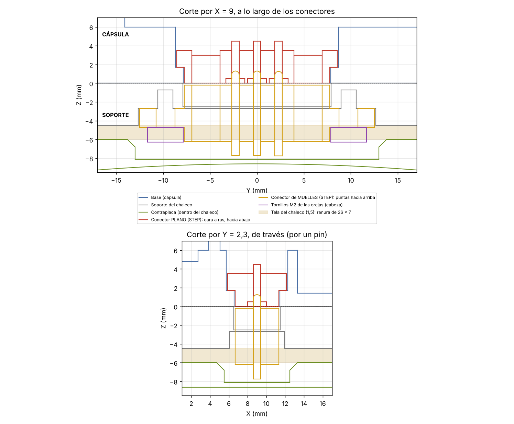

# AVO espalda · Rev E.7.2 · conectores magnéticos de 3 vías en lugar del reed (31/10/2026)

**Estado: diseñado y comprobado con el STEP de los conectores (CAD) · NO PROBADO.** Imprime primero las **probetas**.

**Historial de esta revisión:**
- **E.7:** medidas sacadas de fotos.
- **E.7.1:** soporte montado desde arriba.
- **E.7.2 (esta):** cotas exactas del STEP del usuario, `Assembly Pogo 3er` (Onshape). **No imprimas nada de la E.7 ni de la
  E.7.1.**

**Disposición:**
- **Cápsula (base):** conector **PLANO**, con la cara a ras del fondo y los contactos hacia **abajo**.
- **Soporte del chaleco:** conector de **MUELLES**, con las puntas hacia **arriba**. Las puntas salen 1,3 mm por encima de la cara
  de apoyo y, al poner la cápsula, se aprietan contra el plano.
- **Esquema eléctrico de la E.6:** el soporte une **BAT** y **SYS** → la espalda se enciende al ponerla y queda a 0 V al
  quitarla. La base de carga lleva BAT y GND al cargador.

## 1. Cotas del STEP
| | Conector PLANO (cápsula) | Conector de MUELLES (soporte) |
|---|---|---|
| Cara | óvalo 15,5 × 4,65, 1,7 de alto | óvalo 15,5 × 4,65 |
| Reborde / orejas | reborde 17,1 × 6,25 × 1,8 detrás de la cara | orejas 25,0 × 5,5 × 2,0, **en medio** (de 2,5 a 4,5 desde la cara) |
| Grueso total | 3,5 | **6,0** |
| Patas por detrás | 1,0 | 1,5 (puntas también 1,5) |
| Contactos | 3 × Ø2 a 2,3 entre sí | 3 pines Ø0,8 |
| Imanes | 2 × Ø3 a ±5,42, a ras | 2 × Ø3 a ±5,42, a ras |
| Agujeros de las orejas | — | Ø2,0 a 19,5 (tú mediste Ø2,5) |

## 2. Qué se imprime
STL en posición de impresión, **sin soportes**: 0 voladizos fuera de límite en las 7 piezas (`VALIDACION/voladizos_E7.json`).

| Pieza | Fichero |
|---|---|
| Probeta de la base | `STL/AVO_RevE7_PROBETA_CONECTOR_BASE.stl` |
| Probeta del soporte | `STL/AVO_RevE7_PROBETA_CONECTOR_SOPORTE.stl` |
| Probeta de la base de carga | `STL/AVO_RevE7_PROBETA_CONECTOR_BASE_CARGA.stl` |
| Base E.7.2 | `STL/AVO_RevE7_BASE_IMAN.stl` |
| Soporte del chaleco E.7.2 | `STL/AVO_RevE7_SOPORTE_IMAN.stl` |
| **Contraplaca E.7.2** (nueva: hueco para el conector) | `STL/AVO_RevE7_CONTRAPLACA.stl` (con la cara de la tela en la cama) |
| Base de carga E.7.2 (9 mm de grueso, para la mesa) | `STL/AVO_RevE7_BASE_CARGA_IMAN.stl` |

Sin cambios: tapa E.5, cuna de la Heltec E.6 y junta TPU.

## 3. Cómo va cada conector


**Cápsula — conector plano, metido desde DENTRO:**
- agujero de la cara de 15,7 × 4,85 (0,1 de holgura), del fondo a Z 1,7: la cara de 1,7 queda **justo a ras** del fondo;
- encima, alojamiento del reborde de 17,4 × 6,55, abierto al interior. El reborde apoya en el escalón de Z 1,7, que aguanta el
  empuje de los muelles;
- las patas llegan a Z 4,5, por debajo de la cara superior del suelo (Z 6,0).

**Soporte — conector de muelles, metido desde ABAJO y atornillado:**
- **ventana del cuerpo** de 15,8 × 4,95 hasta la cara de apoyo. La cara de los muelles queda **0,2 mm por debajo** de la cara
  de apoyo, así que las puntas salen 1,3 mm;
- **alojamiento de las orejas**, abierto por abajo, con techo en Z −2,7 (cara superior de las orejas);
- **membrana de 0,2 mm** sobre la ventana: deja imprimir el techo de las orejas como puente. **Córtala con un cúter** antes de
  montar;
- **2 pilotos de Ø1,6 × 2** para tornillos **M2 de rosca chapa** (M2 × 4 o M2 × 5) por los agujeros de las orejas;
- **lo que asoma por debajo del soporte:** 1,7 de cuerpo, las cabezas M2 y 1,5 de patas (hasta Z −7,7). Atraviesa la tela y
  entra en un **hueco de la contraplaca** de 26 × 7 × 2,1 (fondo a Z −8,1; quedan 0,5 mm de piel por detrás).

## 4. Orden de los contactos (los dos conectores, a lo largo de Y)
| Posición | Contacto | Lado de la cápsula |
|---|---|---|
| Y − | **BAT** (+ de la celda, tras el fusible de 1,5 A) | lado del botón USER |
| Centro | **SYS** (+ del conector de batería de la Heltec) | |
| Y + | **GND** | lado opuesto |

Si el sudor une dos contactos vecinos, como mucho se enciende. BAT y GND no están juntos.

## 5. Montaje
1. **Polaridad de los imanes:**
   - acopla los dos conectores a mano;
   - pon el de muelles en el soporte, sin tornillos, y el plano encima;
   - marca con rotulador el extremo del lado del botón USER (Y −) en los dos.
2. **Conector plano:**
   - suelda 3 hilos de 26–28 AWG a sus patas: BAT en el extremo marcado, SYS en el centro y GND en el otro extremo;
   - mételo **desde dentro** de la cápsula, con la cara hacia el agujero del fondo;
   - pon epoxi por encima del reborde. Sella el agujero y lo sujeta cuando los imanes del soporte tiran al sacar la cápsula;
   - comprueba con una regla que la cara queda a ras.
3. **Conector de muelles (soporte del chaleco):**
   - corta la membrana;
   - acorta las patas a ~1 mm y suelda un puente **BAT–SYS** (las dos del extremo marcado) tumbado sobre las patas, sin tocar GND;
   - mételo desde abajo y atorníllalo con 2 × M2 de rosca chapa. Un punto de epoxi en las orejas, si quieres.
4. **Tela del chaleco:** haz una **ranura de 26 × 7 mm** donde va el conector, igual que los 6 agujeros de los tornillos M3.
   Monta la contraplaca nueva por dentro: su hueco recoge el conector, las cabezas M2 y el puente.
5. **Base de carga:** mismo montaje, **sin puente**:
   - BAT a **B+** del TP4056 y GND a **B−**; SYS libre;
   - el cable sale por el canal inferior hacia el cuello;
   - comprueba la polaridad con el polímetro **antes** de poner la cápsula.

## 6. Cableado y firmware
```
 celda + (tras su PCM) ──[ fusible 1,5 A ]──► BAT del conector plano
 SYS del conector plano ───► + del conector de batería de la Heltec (JST 1,25)
 celda − ──┬──► − del conector de batería de la Heltec
           └──► GND del conector plano
 Sin cambios: Pololu (VIN en el 3V3 de la Heltec, SHDN en GPIO34), UART del ZED (RX GPIO35, TX GPIO33). Se quita el reed.
```
- **Firmware:** no cambia (la 3.13.11 ya va sin reed).
- **Consecuencia:** fuera del soporte el USB-C de la Heltec no carga la celda. Hay que cargar en el soporte o en la base de carga.

## 7. Comprobaciones hechas (con el STEP colocado en las piezas)
- **Conector plano / base:** 0 mm³ de interferencia. Cara a Z 0,00, a ras.
- **Conector de muelles / soporte:** la única interferencia es la membrana de 0,2 (13,5 mm³, prevista).
- **Conector de muelles / contraplaca:** 0 mm³. Las cabezas M2 tampoco tocan.
- **Alturas:**
  - cara de los muelles a Z −0,2 y puntas a Z +1,3;
  - fondo del conector a −6,2 y patas a −7,74;
  - fondo del hueco de la contraplaca a −8,1.
- **Mallas:** cerradas, 1 cuerpo, sin autointersecciones (`VALIDACION/validacion_E7.json`).
- **Datos:** `VALIDACION/interferencias_conectores_STEP.json`.

**Pendiente:**
- comprobar con las probetas que tu conector es como el STEP: grueso de 6,0 y orejas en medio (en las fotos parecían más finas);
- comprobar el diámetro de los agujeros: el STEP dice Ø2,0 y tú mediste Ø2,5. Con Ø2,5 entra el M2 igual;
- probar el rebote del contacto al galope.

## 8. Fuente
`fuente/avo_v22h_revE7_freecad.py` (parámetros `PL_*`, `PN_*`, `CON_C`, `MT_CARGA`).
`fuente/e7_sec.py` coloca el STEP de los conectores (`fuente/ref/Assembly_Pogo_3er.step`) y comprueba interferencias.
